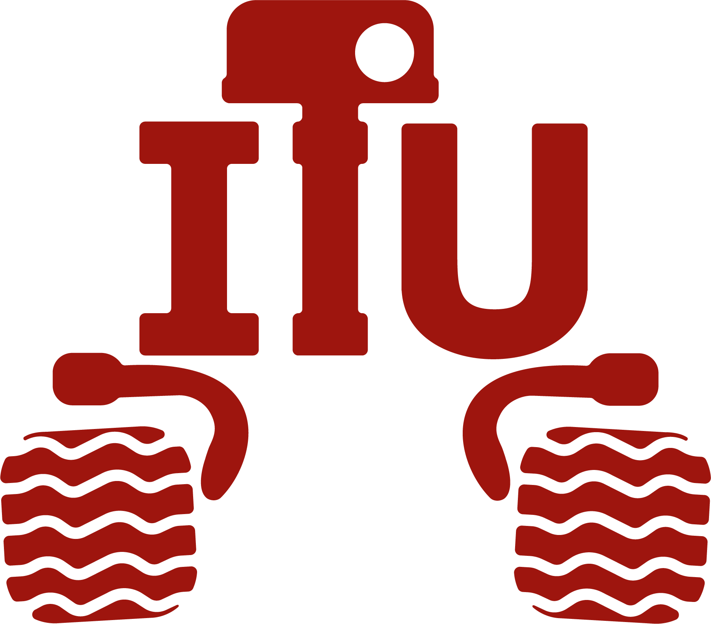

<div align="center">

</div>

**ITU Rover Görüntü İşleme Görevi**

Bu görevde, ROS 2 kullanarak bir görüntü işleme node'u oluşturmanızı beklemekteyiz. Sizlere sunduğumuz `rosbag/assignment` dosyasında bulunan **/video_topic/compressed** topic'i üzerinden bir video yayını sağlanmıştır. Ayrıca başlatacağınız **'itu_rover_node'** her 2 saniyede bir bu yayına uygulanacak rastgele bir görüntü işleme tekniği **/filter** topic'i üzerinden yayınlanmaktadır.

Göreviniz, dinlediğiniz görüntü işleme tekniklerini video yayınına uygulamak ve sonucu **/rover_view/compressed** topic'i üzerinden yayınlamaktır.

# Kurulum

### Ubuntu Kurulumu
Eğer Ubuntu 22.04 işletim sistemi kurulu bir bilgisayarınız varsa bu adımı atlayabilirsiniz.
İTÜ Rover takımında ROS 2 Humble dağıtımı kullanılıyor. Bu nedenle beraber çalışabilmemiz için
Ubuntu 22.04 yüklü bir sisteminiz olması gerekmektedir.

### Linux Kullanımı

Aşağıdaki linkten temel Linux komutlarını öğrenip deneyebilirsiniz.

https://aktif.net/linux-komutlari/

### ROS 2 Humble Kurulumu
Aşağıdaki linkten öğrenerek Ubuntu’ya ROS 2 Humble kurulumunu tamamlayın.

https://docs.ros.org/en/humble/Installation/Ubuntu-Install-Debs.html

### Paket Kurulumu

Bir workspace oluşturun ve bu paketi klonlayıp derleyin.

```bash
mkdir -p ~/rover_ws/src
cd ~/rover_ws/src
git clone https://github.com/itu-rover/iturover_processing_assignment
cd ~/rover_ws
colcon build
source install/setup.bash
```

# Görev Adımları
Aşağıda adımları sırasıyla bulabilirsiniz:

1. ROS 2 bag dosyasını başlatın:
   ```bash
   ros2 launch iturover_processing_assignment rosbag.launch.py
   ```

2. Görüntü işleme komutlarını içeren scripti çalıştırın:
   ```bash
   ros2 run iturover_processing_assignment filter_publisher.py
   ```

3. **/video_topic/compressed** topic'ine gelen [sensor_msgs/msg/CompressedImage](https://docs.ros2.org/humble/api/sensor_msgs/msg/CompressedImage.html) mesaj türündeki video akışını ve **/filter** topic'ine gelen [std_msgs/msg/String](https://docs.ros2.org/humble/api/std_msgs/msg/String.html) komutlarını dinleyin.

4. Gelen görüntü işleme tekniklerini video akışına uygulayın.

   **GRAY**: Video akışını gri tonlamalı hale dönüştürür.
   
   **RGB**: Video akışını RGB tonlamalı hale dönüştürür.
   
   **RESIZE_UP**: Video akışının boyutunu iki katına çıkarır.
   
   **RESIZE_DOWN** :Video akışının boyutunu ikiye böler.
   
5. Elde edilen işlenmiş görüntüyü [sensor_msgs/msg/CompressedImage](https://docs.ros2.org/humble/api/sensor_msgs/msg/CompressedImage.html) mesaj türünde **/rover_view/compressed** topic'ine yayınlayın.

Bu adımları takip ederek görevinizi tamamlayabilirsiniz. Başarılar dileriz!


https://github.com/itu-rover/iturover_processing_assignment/assets/99661459/57722f7b-8e00-47a1-9cb1-2acb91781dcc


# Ayrıca bakınız
* https://docs.opencv.org/
* https://docs.ros.org/en/humble/p/cv_bridge/
